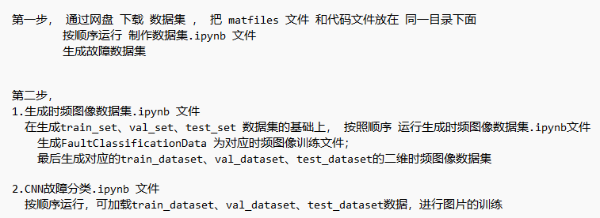
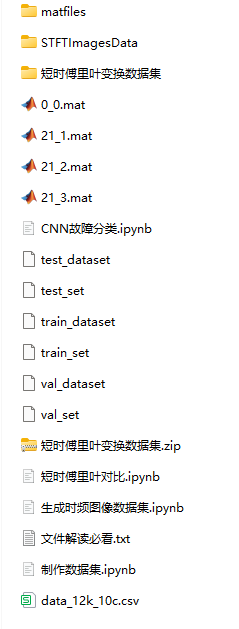

# Python bearing fault diagnosis time-frequency image processing - Short Time Fourier Transform STFT

Please remember to install Jupyter with pip for running the code.
Then, follow the file order and run the code step by step, otherwise, directly running the classification code will result in errors!
1. Create a dataset.ipynb
2. Generate time-frequency image dataset.ipynb
3. CNN fault classification.ipynb
The Pycharm code files have been uploaded, and you can update and download them now!
This includes the complete CWRU bearing fault dataset, as well as the one-dimensional fault signal dataset and time-frequency image dataset that have been generated and prepared. The corresponding codes can be run.
Environment: Python 3.9
\n\n\n\n

## Images

<!-- PAYMENT_BLOCK -->

## Get this dataset

- Payment link (Stripe): [Buy now](https://buy.stripe.com/3cs8yP7sY87d0vu9AB)
- Payment QR code: 

<!-- /PAYMENT_BLOCK -->
